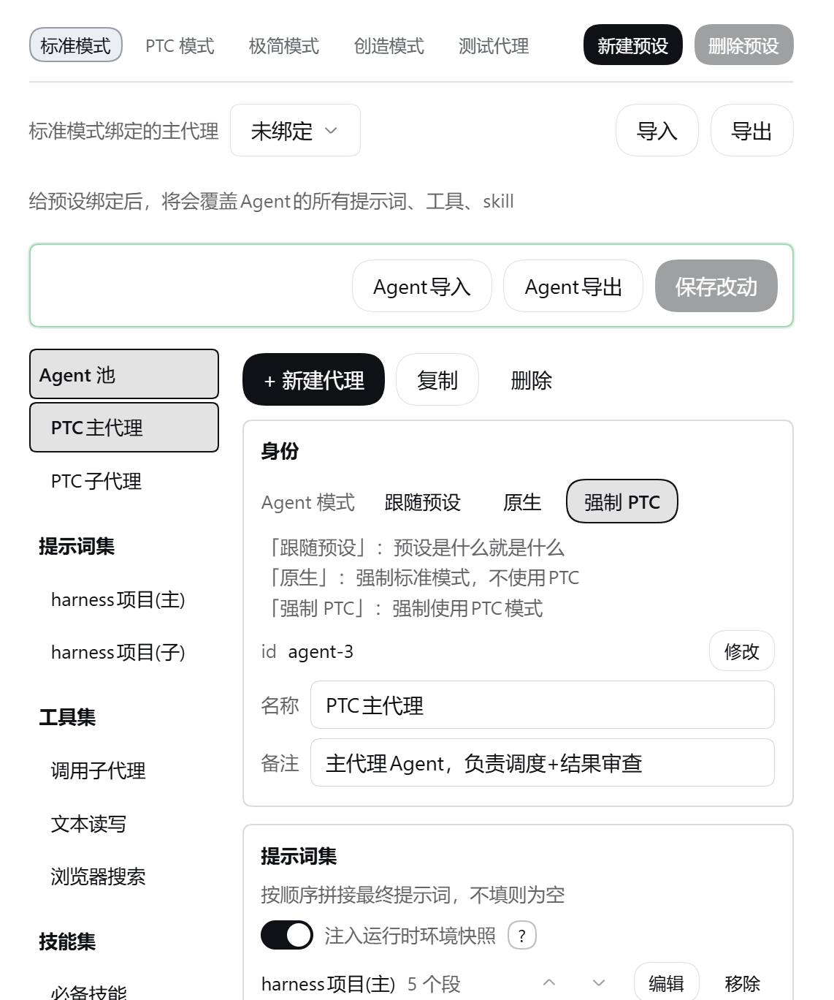
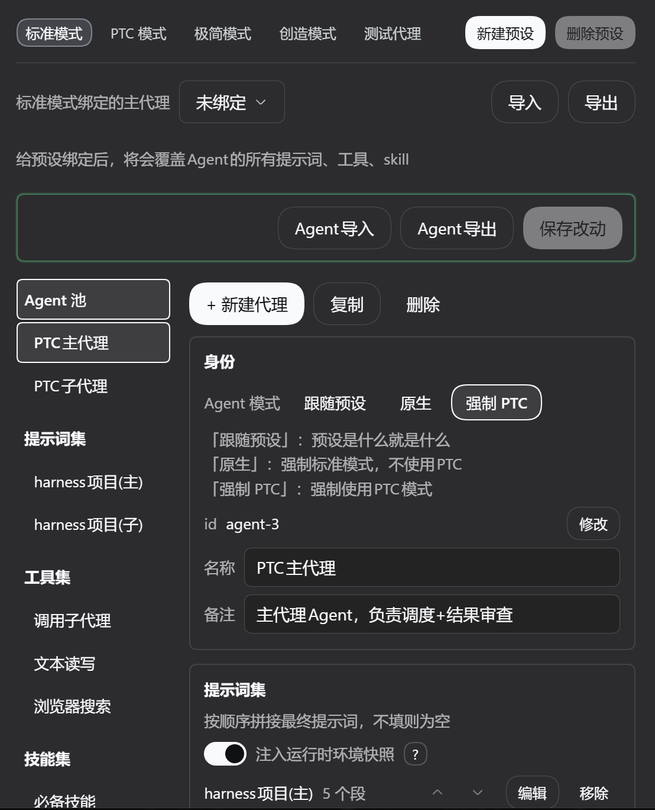
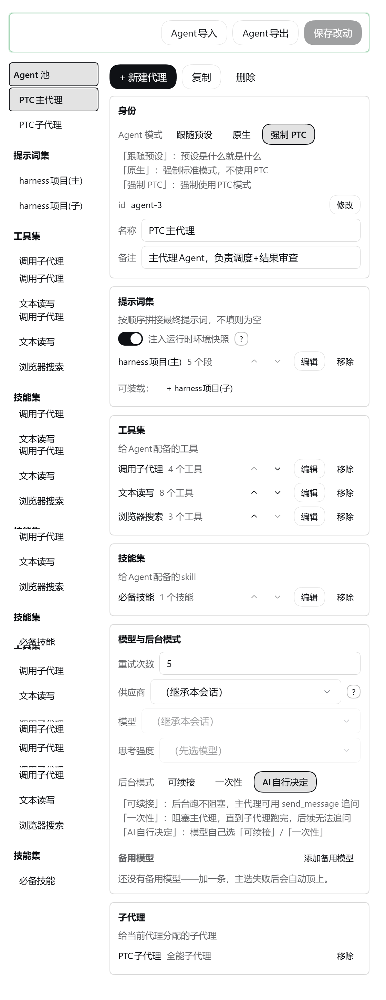
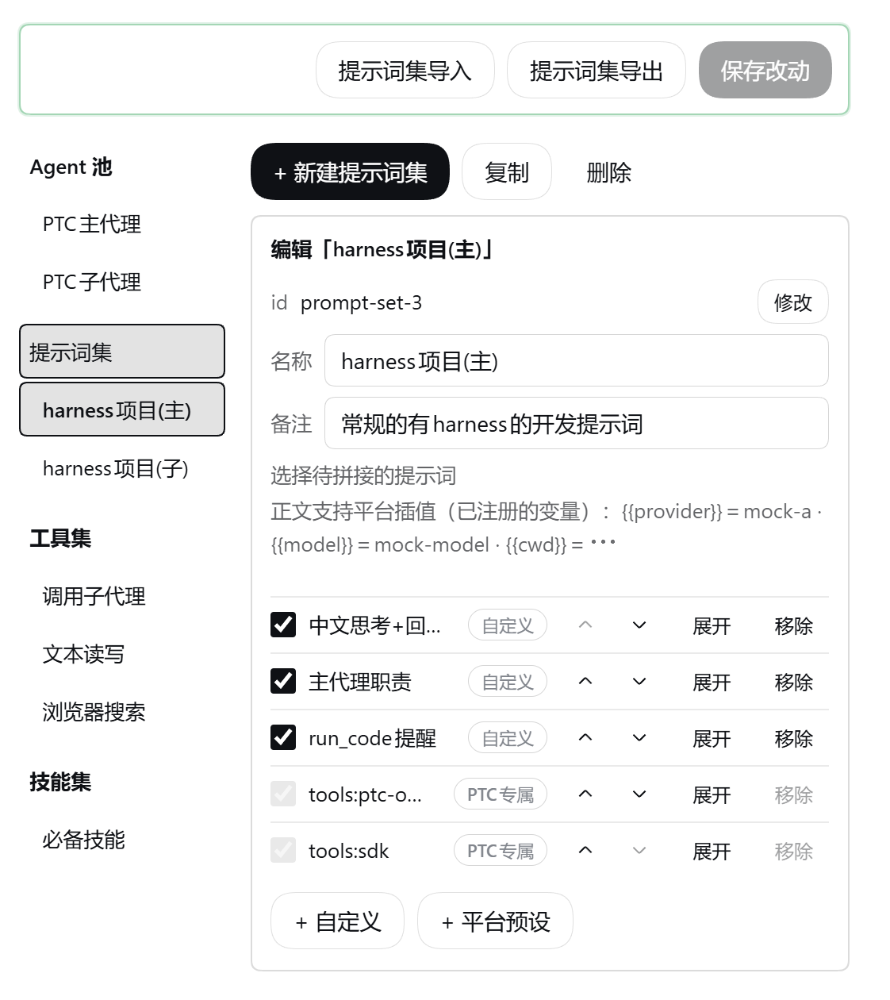
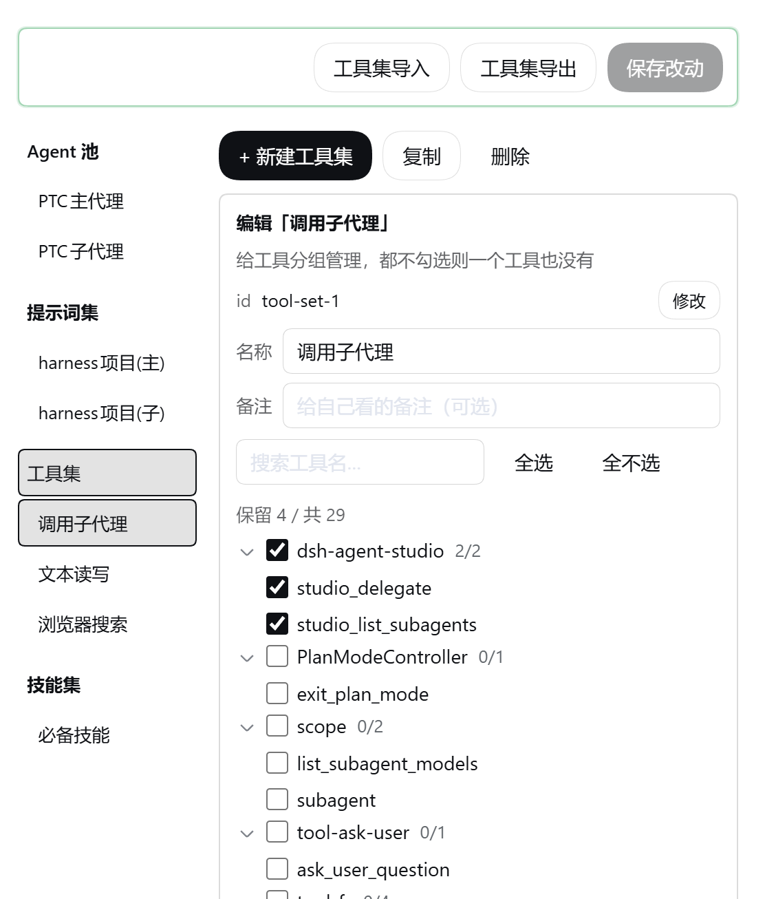
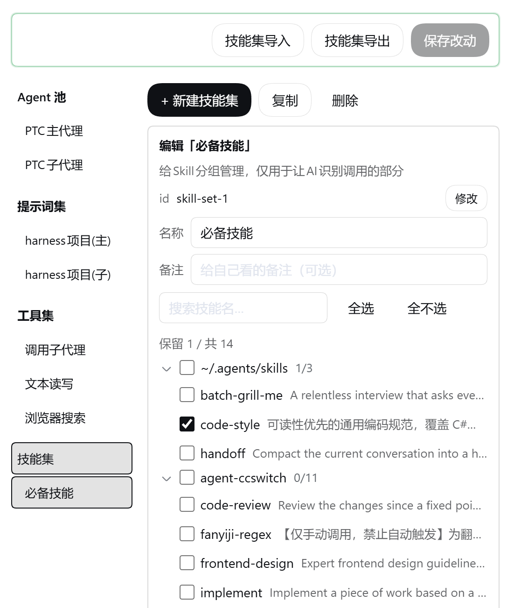

# dsh-agent-studio

[](https://thissensen.github.io/dsh-agent-studio/)
[](https://www.npmjs.com/package/dsh-agent-studio)
[](https://github.com/thissensen/dsh-agent-studio/actions/workflows/ci.yml)
[](./LICENSE)

**简体中文** · [English](README.en.md) · [在线文档](https://thissensen.github.io/dsh-agent-studio/)

一个 [DeepSeek Harness](https://github.com/deepseek-ai/deepseek-harness) 图形化插件：**可视化地精确配置 Agent 的提示词（prompt）、工具（tools）、可见技能（skills）、子代理、备用模型，轻松创建团队，根据不同任务分配不同模型**。

模型每一轮看到的东西就三份：**系统提示词**、**工具目录**、**技能目录**。随着插件、工具、MCP 越装越多，这三份只会越来越大，拖累模型表现。另外 DSH 目前给子代理的配置极其简陋，没法轻松配置它的提示词、工具、技能、模型和思考强度。

本插件的配置**存在自己的数据里**，不改动宿主既有的预设定义，卸载即恢复原状。

它把 Agent 拆成可随意拼装的积木：提示词、工具、技能、模型拼成一个完整 Agent，**子代理也一样能高度定制**；预设可以随手新建；工具怎么呈现按预设分三档（继承部署默认 / 原生 / PTC），在面板顶栏直接切；支持跨供应商的备用候选模型。

可以搭配 [dsh-context](https://github.com/bowenliang123/dsh-context) 一起用，查看模型这一轮实际收到的提示词、工具和 skill 到底长什么样。

## 它解决什么

| 你可能遇到过的问题                      | 平台的默认行为                              | 装上之后                               |
| ------------------------------ | ------------------------------------ | ---------------------------------- |
| 系统提示词越堆越长，关不掉也用不上              | 预设里注册了哪些段就投递哪些段                      | 按 agent 编一份白名单，名单外的段不进上下文          |
| 工具越装越多，同类工具一大堆，模型挑不准           | 工具面按已装的插件全量下发                        | 挑出这个 agent 要用的，其余收起来               |
| 技能多了不好管                        | 所有 `modelInvocable` 的 skill 都进目录     | 勾哪些就给哪些，不勾的模型看不见                   |
| 每个 step 都塞一段运行时快照              | 官方按 step 动态注入，没有开关                   | 代理级开关，可选部分关掉就不用再收              |
| 子代理只能整套继承主代理，占用大量上下文           | 官方 `subagent` 既没有条目标识，也没法按角色裁剪       | 每个子代理独立配：模型 / 提示词 / 工具 / 技能 / 后台模式 |
| 子代理的执行方式说不清                  | 平台按预设里挂的执行器行决定，面板里没处选        | 子代理的执行方式由它所在的预设决定（平台机制），面板上按预设切三档 |
| 干不同的活想用不同的提示词、工具、Skill，切来切去很麻烦 | 预设只管提示词组合，工具和 skill 是全局一套，换个预设照旧全量下发 | 给预设挂的 Agent 一切换即可                  |
| 本地部署模型上下文紧张，根本对话不了几轮           | 做不到提示词全清，只能创造模式自己建一个                 | 创建一个什么都不挂的 Agent，给预设绑上就行，真 · 0提示词   |
| 主模型限流了 / 挂了，整轮直接失败             | 只在一个 provider 里重试到上限，然后放弃            | 配一条**备用候选链**（可跨供应商），失败按顺序顶上        |

## 安装

按你手头的条件挑一条：有网络就用 npm，内网或离线用 GitHub Release 的安装包，想改代码就走源码。

### 从 npm

```sh
dsh plugin --profile web add dsh-agent-studio
```

### 从 GitHub Release 下载

到 [Releases](https://github.com/thissensen/dsh-agent-studio/releases) 下载 `dsh-agent-studio-<版本>.tgz`，它就是 npm 上那份包，`lib/` 与 `client/` 的构建产物都在里面，不用自己构建：

```sh
dsh plugin --profile web add "./dsh-agent-studio-0.2.1.tgz"
```

包放在哪个目录都行，把路径写对即可（`./` 开头或绝对路径），文件名里的版本号换成你实际下载的那个。**离线、内网环境走这条。**

### 从源码

```sh
git clone https://github.com/thissensen/dsh-agent-studio.git dsh-agent-studio
cd dsh-agent-studio

pnpm install                      # 只装 devDependencies；peer 是宿主包，不走 registry
node scripts/link-deps.mjs web    # 把宿主的 @deepseek-ai/* 链进本项目的 node_modules
dsh plugin --profile web add "link:<本目录的绝对路径>"
```

也可以把 Release 页的源码压缩包（`Source code (zip)`）解压出来代替 `git clone`，后续步骤一样。

三条路装完都**重启一次 DSH**，在 **设置 → Agent 中心** 看到面板就成了。

- `link:` 装法下改 `lib/` 立即生效；**改面板（`client/parts/panel.js`）刷新页面**就行，不用重启。
- 改 `package.json` 的入口类字段（`main` / `exports` / `dsh.*`）后必须重启。
- `--profile` 填 `web`（纯 Web 版）或 `desktop`（桌面版）。桌面版就是 Web 版加一层 Electron 壳，host 半边一行不用改。

### 卸载

```sh
dsh plugin --profile web remove dsh-agent-studio
```

卸载后宿主配置里不留任何痕迹。预设从没被改过，其余配置都在插件自己的数据里。

## 面板预览

界面有浅色、深色两套：

<p align="center">
  
  
</p>

> 截图为较早界面：导入 / 导出现已合并到顶栏的同一棵勾选树，后台模式已收成两档（不阻塞 / 阻塞）。









| 区域          | 做什么                                                          |
| ----------- | ------------------------------------------------------------ |
| 左侧「Agent 池」 | 每个 agent 一条：绑哪个预设、装哪些集、子代理名册                                |
| 左侧集库        | 提示词集 / 工具集 / 技能集三类列表：新建、复制、改名、删除                       |
| 右侧详情        | 选中集 → 编成员；选中 agent → 装载集、配模型与后台模式、挂子代理、切快照开关                   |
| 顶栏          | 预设 tab 与新建 / 删除预设、预设呈现方式、主代理绑定、导入 / 导出（都走同一棵勾选树；导出的是草稿，含未保存的改动）       |
| 底栏          | 注册到主页面与突破 PTC 120 秒限制两个开关、保存态与保存改动                                                |

导入先选文件、再在树里勾要并进草稿的项；导出也在同一棵树里挑池与项（**只含四个池，不带预设绑定与开关**）。树里的**「是否覆盖」**开关决定撞 id 时是覆盖还是报错（默认关 = 报错）；导入只并入草稿，点了保存才落盘。

**注册到主页面**：开启时主页面直接显示 Agent 中心面板、左栏出现入口；关掉后两者一起隐藏（主区回到会话页），随时可以去「设置 → Agent 中心」重开。它改的是全局开关，与草稿无关，点一下即时生效。

改 id 之前会先列出谁在引用它，改的时候把所有引用一并同步，不留悬空引用。

## 四个池，互相独立

四类配置对象各管各的，可以多对多引用。集建好之后，能被多个 agent 装载。

| 池                     | 干什么用                                                              |
| --------------------- | ----------------------------------------------------------------- |
| **代理** `Agents`       | 指定绑给哪个预设；配提示词、工具、skill、子代理名册，以及被当子代理时的模型与思考强度 |
| **提示词集** `promptSets` | 有序的提示词清单，顺序可调                                                     |
| **工具集** `toolSets`    | 工具名清单，插件的和 MCP 的都在里面                                              |
| **技能集** `skillSets`   | Skill 清单，决定哪些能被 AI 自主调用                                           |

- **装载**：把集挂到 Agent 上。同一个 Agent 装载的集之间不允许有重叠成员，界面和写入端点各拦一道。
- **绑定**：把某个预设绑到一个 Agent 上，这个预设就交给它管了。

## 语义边界

绑定之后，这个预设就归这个 Agent 管。三面一个规矩：**没装就是空的**。

| 概念   | 规则                                            |
| ---- | --------------------------------------------- |
| 绑定预设 | 被绑定的预设，提示词、工具、skill、子代理全部交给这个 Agent；解除绑定即恢复原样 |
| 提示词集 | 一个都不装 = 投递空提示词                                |
| 工具集  | 一个都不装 = 一个工具都不给                               |
| 技能集  | 一个都不装 = 一个 skill 都不暴露；装了就只看勾的                 |

## 模型自动降级（可选）

给代理配一条**备用候选链**，主选失败就按链依次顶上。**不配备用候选 = 完全不接管**，重试行为与平台默认一致。

- **重试次数**：每个候选**各自**的上限，默认 5（与平台默认对齐）。可重试的错误（空响应 / 限流 / 服务端错误 / 超时 / 传输错误）在当前候选上重试到上限，才换下一个候选；额度耗尽、凭据失效这类错误不重试，直接换。
- **链怎么排**：子代理 = 启动时给的路由（没配模型就是继承）→ 备用候选；主代理 = 对话界面选的模型 → 主模型配置 → 备用候选——**不抢你的选择**，一切正常时插件不碰它。
- **失败的样子**：全链走完 = 这次请求彻底失败（与平台一致）。换候选后**当次会话不自动切回**；你在对话界面手动换模型，插件让位。
- **看得见**：重试与切换写进会话（界面上的「正在重试模型请求（N/M）」就是它），换候选还会给模型留一条通知，让它知道上文的产出模型变了。

## 快速上手

1. **打开面板**：设置 → Agent 中心。左边是 Agent 池和提示词、工具、Skill 三个集库，右边是详情。
2. **建一个提示词集**，往里加提示词段。段有两种：
   - **平台预设**：引用平台自己注册的段，正文跟着平台升级走，面板里只读；
   - **自定义**：自己写正文，支持平台注册的 `{{变量}}` 插值。写了平台没注册的变量名，这次请求会直接失败。
3. **建一个工具集**，勾你要留下的工具。`skill` 是必配项，没有它 AI 没法自主调用 Skill。
4. **建一个技能集**，勾要暴露给模型的 skill。候选按来源分组，可折叠，也可以整组勾选；打开面板就直接问官方技能服务要候选，不用先发一条消息。
5. **建一个代理**：填名字与备注（被当子代理时，模型靠这行备注决定把活派给谁），装上前面那些集，选后台模式（不阻塞 / 阻塞）。**呈现方式在顶栏按预设切**，不在这里。**派活永远是一批 `tasks`**（派一个也写成一项），等不等由目标代理自己的后台模式决定。子代理名册也在这里挂。需要的话再配**备用候选模型**（见上节，可选）。
6. **绑定**：把这个代理绑到一个平台预设上。
7. **保存**。只有点了保存才落盘，**别忘**。

保存之后，用这个预设开个新对话就生效了。

## 配置与数据

配置存在插件自己的 settings 命名空间 `agent-studio` 下（在用户配置文件 `settings.yaml` 里）。模型是四个键加一份绑定：

```yaml
agent-studio:
  agents:        # 代理池
    - id: reviewer
      name: 代码评审
      note: 只读代码、给评审意见          # 被当子代理时，模型靠它决定把活派给谁
      model: { provider: deepseek, model: deepseek-v4.1-flash, reasoningEffort: medium }
      maxRetries: 5                   # 自动降级：每个候选各自重试的上限（默认 5）
      fallbacks:                      # 备用候选链（可跨供应商）；空 = 不接管
        - { provider: senseaudio, model: glm-5.3-flash }
      background: foreground          # always-background | foreground
      promptSets: [review-sections]   # 有序：集在这里的顺序就是段的投递顺序
      toolSets: [read-only]
      skillSets: [review-skills]
      children: [tester]              # 可以派出去的子代理名册
  promptSets:    # 提示词集：有序段清单；带 text = 自定义，不带 = 引用平台预设
  toolSets:      # 工具集：工具名清单
  skillSets:     # 技能集：skill 名清单
  runtimeContextOff: [reviewer]       # 名单里的代理：关掉快照的「可选」部分，平台必需的项仍照投
  bindings:
    presets: [{ presetId: standard, agentId: reviewer }]   # 预设 → 主代理
```

保存行上的那两个开关对应两个顶层键（与草稿无关）：`mountMainPage`（注册到主页面）与 `ptcBreakLimit`（突破 PTC 120 秒限制，默认开）。两个都是**界面偏好**，点一下即时落盘、不进面板草稿。

**这些列表全是数组，不是字典。** 设置服务的合并语义是「对象递归、数组整体替换」，用字典的话界面永远删不掉一个成员。代价是 id 唯一性得自己保证，由界面和写入端点把关。

## 兼容性

- **目标环境**：纯 Web 版（`dsh --profile web`）与桌面版（`dsh --profile desktop`）都行——桌面版是 Web 版加一层 Electron 壳，host 半边同一套代码，平台版本要求也一样。
- **依赖的宿主服务**：七个平台包写在 `peerDependencies` 里，并且**指明版本**（`>=0.2.2-rc.1`，与 `engines.dsh` 同串）——这是插件市场与平台判断「能不能装」的依据：版本不够时市场拦住更新、启动门禁整份跳过 bundle，而不是让你装完启动失败。只有 `schemastery` 是可选的。这个下界写的是**全功能最低版本**：呈现方式与工具面走的是 0.2.2 的平台契约。两个工具执行器包（`-native` / `-ptc`）不进 peer——插件只在预设构成里写执行器行，从不 import 它们。
- **界面语言与主题**跟随平台，自带中文 / English 两套文案，深色浅色都能看。
- **client 半边零构建**：`client/index.js` 是壳（启动时加载），`client/parts/panel.js` 是面板（由 host 路由运行时按需伺服）。

### 已知边界

- **极简类预设（`minimal`）的段面改不动。** 这类预设的 persona 段带了 `complete: true` 标记，意思是「我就是完整的提示词，别再拼别的」。平台会在装配瀑布**跑完之后**把段清单强制换回那一段，插件在瀑布里算出来的白名单因此被盖掉——最终投递的永远是那一段。这是平台设计，不是插件的缺陷，而且它本来就只剩一段，损失有限。工具面、技能面没有这道后处理；`standard` / `code` / `cordis` 这类常规预设的段面也一切正常。
- **派活用插件自带的工具**：`studio_list_subagents` 现算子代理名册，`studio_delegate` 按代理 id 派活——**只有走它，子代理那套独立配置（提示词 / 工具 / 技能 / 模型）才认得出身份、才生效**。官方 `subagent` 工具不受特殊对待（工具集里有它就在），但它派出的子代理没有角色登记，只能按「这个预设绑定的主代理」那套面走。
- **同时派多个子代理，身份也配得准。** 每次派活都在调用**之前**预生成子会话 id——前台等结果与后台跑两档都是可续接的子会话，「子会话 → 代理」的映射先于创建写好，配对是精确的。平台在 `agent/created` 事件里不告诉插件「这次创建是哪一次派活触发的」，所以身份只能靠派活前登记这一条路。
- **派活只有一种形状：一批 `tasks`，等不等看目标那档。** `studio_delegate` 的入口只有一个 `tasks` 数组（派一个也写成一项），没有「单发」参数，也没有「要不要在后台跑」的参数——整批阻不阻塞由目标代理各自的**后台模式**决定，判定是 OR：**一项「阻塞」就整批阻塞**。代价是不阻塞的那几项会被同批连坐（一次工具调用只能交回一次结果，这是有意的取舍）。
  - **一项都不阻塞 ⇒ `{ kind: 'started', items }`**：调用立刻返回，每个子代理跑完由**平台逐条**发结算消息（带它的完整收尾文本）。每项 `{ agent, subagentId?, description?, error? }`；启动失败的那项没有 `subagentId`、带 `error`。
  - **至少一项阻塞 ⇒ `{ kind: 'foreground-batch', results, filePath?, fileError? }`**：整批一起启动、一起等，全部结算后返回；每项 `{ agent, ok, subagentId?, description?, error? }`。批量本身不限条数，但平台同时跑的子代理有上限（可在平台设置里调），到顶时超出的那几项各自返回错误并提示**拆成单独一次重派**，其余照常——一项失败不连坐整批。
  - **阻塞批的结果一律落盘，对话里只留一行落点。** 整批结果会写进系统临时目录下的一个 `.md`：`<系统 temp>/dsh-agent-studio/<会话 id 短哈希>/delegate-<UTC 时间戳>.md`，路径放在返回的顶层 `filePath` 上。文件里是**成功项的正文**，按原序号分节；失败项没有正文，原因在返回里。工具结果在对话里只有这几行：`本批结果已写入：<路径>（共 N 项：M 成功 · K 失败）`，失败项各占一行（`【序号】代理（名字） — 描述 · 失败 · 原因`），另有一行 `子代理：【序号】<id>、…`，列出本批每个可续聊的子代理会话（启动就没起来的项没有 id，不列）——**正文不进对话**，要读就按那个路径读文件；`results` 不含正文（写盘失败也不回填）。写盘失败时返回里换成 `fileError`、那一行改报原因：`文件没写成（<原因>）（共 N 项：M 成功 · K 失败）`。这些文件插件**不主动清理**。
- **工具候选不用先对话。** 预设注册即激活，面板直接读该预设此刻的工具面（`GET /tools?preset=`）；读不到时（工具服务缺席、预设破损）才退回按预设落盘的观察缓存。
- **自动降级只在配了备用候选时接管。** 候选链为空时插件完全不碰请求，重试就是平台默认的那套；接管之后重试上限以插件配置为准（每个候选各自算）。
- **「突破 PTC 120 秒限制」是进程级开关，默认开。** 它在保存行「注册到主页面」右边，点一下即时落盘、不进草稿：把 PTC 模式 `run_code` 程序的预算从默认 120 秒抬到平台计时器上限（约 24.8 天）。三点要记住：① 只对 PTC 模式生效，而且是**进程级全局**——主代理、子代理、所有程序一起放开；② 等后台 job、等嵌套工具的时间也算在这份预算里；③ 打开后写坏的死循环几乎不会自己停，只能手动中断。默认开是因为「阻塞」档的派活经常要等超过 120 秒。
- **原生模式下 `subagent` / `list_subagent_models` 会重新出现在工具声明里。** 这两个工具注册在 agent 本层，平台的 `restrict()` 按设计收不到它们，而声明层的裁剪在 0.2.2 已经没有落点 ⇒ 只能靠 guard 在调用时拦下：模型看得到、调不动，调用会被拒绝。PTC 模式下它们的声明由 `tools:sdk` 正文裁掉，没有这个现象。

## 从上一版升级

- **只支持 DSH `0.2.2-rc.1` 及以上**，没有为旧平台留兼容分支。
- **先升平台、再升插件**：插件的最低版本高于你手上的平台时，启动门禁会把整份 bundle 跳过——插件看起来「消失」了，不是崩溃。
- **agent 级的呈现开关已删除**：旧配置里的 `toolPresentation` 键不再生效，也不必手工清理。
- **呈现方式改成预设级三档**（继承部署默认 / 原生 / PTC），在顶栏按预设切；改完只对之后新建 / 重绑的会话生效。
- **旧写法会被认出来**：预设里用 `@deepseek-ai/dsh-agent-tool-presentation` 声明呈现方式的，面板标成「原生（旧写法）」/「PTC（旧写法）」，点一次新的档位就换成新写法；选「继承部署默认」会把这份预设里的呈现行（新旧都算）一起删掉。

## 升级注意：派活形态变了

四条破坏性变更，升级前先看一眼：

- **老的「AI 决定」按「不阻塞」读。** 后台模式只剩「不阻塞 / 阻塞」两档，老配置里的第三档 `model-decides` 读出来一律当「不阻塞」——这是**行为翻转**：以前由模型临场决定等不等，现在固定不等。
- **「子代理结果合并返回」开关消失，批量恒可用。** `mergeSubagentResults` 字段没了；`studio_delegate` 永远收一批 `tasks`，不必先打开某个开关。
- **`run_in_background` 参数与单发参数删除。** `agent` / `prompt` 这两个单发参数一起删了，模型必须用 `tasks`（派一个也写成一项数组）；等不等只看目标代理自己的后台模式。
- **后台批次不再有汇总消息，「超限才转存」也换成了「一律落盘」。** 后台批次、`batchId`、汇总消息全部删除，改用平台自己的**逐条结算通知**——每个子代理跑完各发一条，带它的完整收尾文本。旧的转存兜底（结果超长才写文件）一并删除：现在每个阻塞批都写一个文件，对话里只留落点行、子代理行与失败清单（见「已知边界」）。

## 目录结构

```
lib/                  host 半边产物（npm 包的实际入口，tsc 从 src/host/ 生成）
  index.js            入口：挂观察层 + 路由 + 生效层 + 派活工具
  config.js           四个池的 schema + 装载重叠校验（数据模型的唯一真源）
  preset.js           「当前 agent 跑在哪个预设上」的唯一出口
  observe.js          装配期只读观察层
  cache.js            观察结果的磁盘缓存（`/tools` 实时端点读不到时的回退源）
  apply.js            装配期生效层（主代理拼装 + 子代理创建窗口挂钩）
  delegate.js         派活工具 + 子代理身份登记（会话 id → 代理）
  delegate-batch.js   阻塞批的落点行与文件排版（一行落点 + 子代理行 + 失败清单、文件按项分节）
  fallback.js         模型自动降级（候选链 / 每候选重试 / 换候选通知）
  presets.js          预设管理（列表 / 复制 / 删除，走官方服务）
  preset-registry.js  自建预设的运行时注册表（谁注册了 / 注销器 / 重启后重放）
  preset-yaml.js      预设构成声明的 YAML 方言（读写同一份口径）
  preset-presentation.js  预设呈现方式的读写（三档的判定与改写）
  models.js           模型目录（provider / 模型 / 推理档位）
  attribution.js      工具来源归因（注册时刻记「谁注册的」，best-effort）
  sdk-strip.js        PTC 的 tools:sdk 声明正文裁剪
  ptc-budget.js       「突破 PTC 120 秒限制」（抬 PTC 程序预算，关掉写回原值）
  api.js              host 侧路由分发
  http-guard.js       HTTP 请求围栏与响应工具
  types.js            共享类型（只出类型，无运行时代码）
client/               client 半边产物
  index.js            壳：注册模块 + 运行时加载面板 + 失败兜底卡片
  parts/panel.js      面板实现（host 运行时伺服；改它刷新页面即生效）
src/host/  src/client/   源码真源（tsc → lib/，vite → client/）
types/                宿主类型声明
assets/               README 用的截图
scripts/              依赖链接（从源码安装用）与一致性检查（CI 用）
```

## 文档

在线文档：**<https://thissensen.github.io/dsh-agent-studio/>**（源码在 `docs/`，VitePress 站着）。

平台侧的权威来源仍是
[DeepSeek Harness 官方仓库](https://github.com/deepseek-ai/deepseek-harness)与官方文档站。

## License

[MIT](LICENSE)
